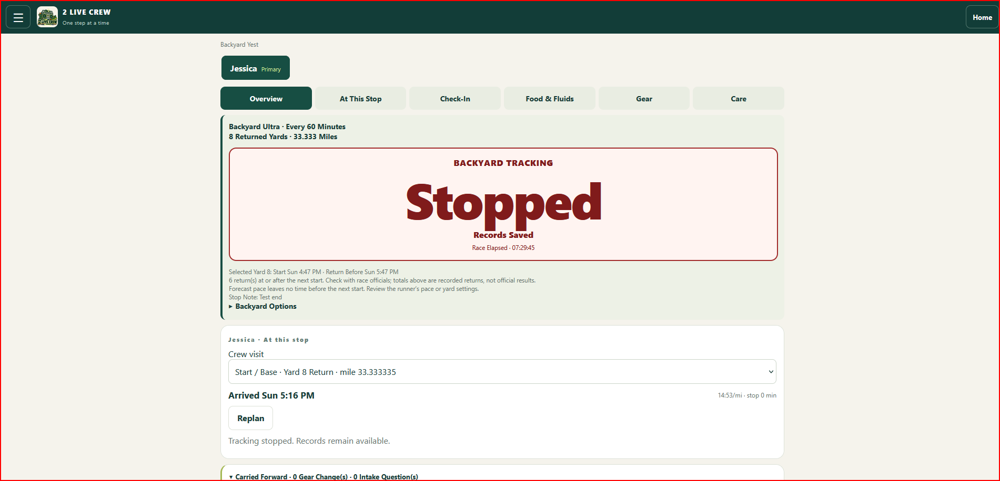
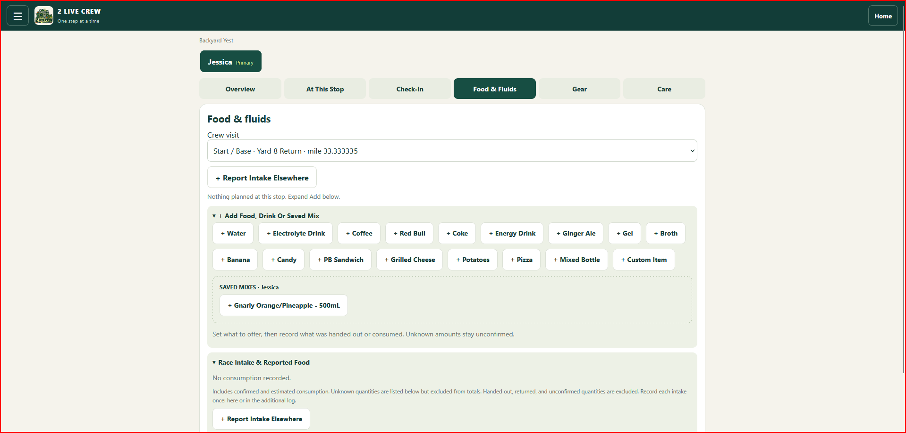
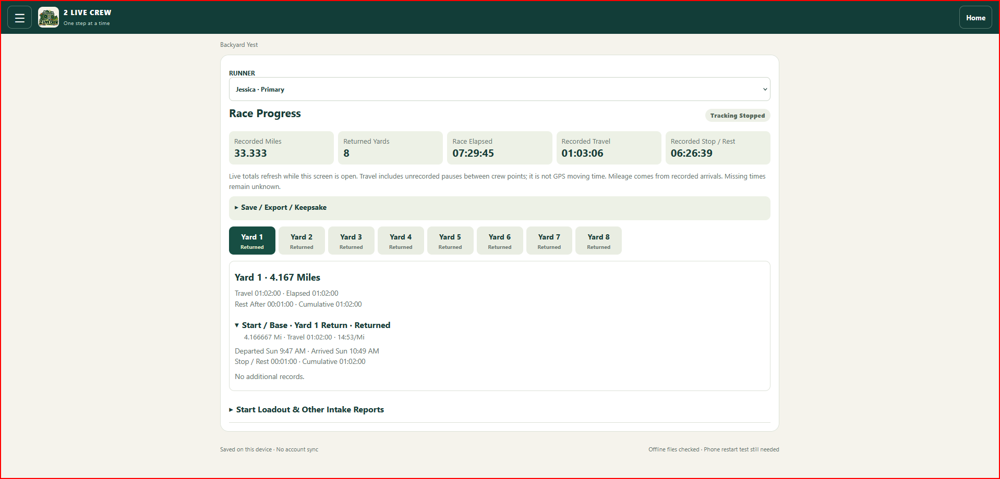

# 2 Live Crew

**One step at a time.**

A phone-first ultramarathon crew notebook: prepare the next stop, record what happened, and keep the runner moving with fewer things to remember.

## What it does

- Multiple runners and races, with a primary runner.
- Ordered courses, repeated loops, timed races, and Backyard Ultra yards.
- Arrival estimates that use recorded stretches and planned stop time.
- Planned versus actual food, fluids, mixes, gear, and care.
- Intake offered versus consumed, including reports from other aid stations.
- Runner check-ins, rest/nap records, conditions, and carried-forward follow-ups.
- Large Backyard countdown with five-minute color emphasis and one-tap returns/starts.
- Live race progress, split CSV, printable reports, and customizable keepsakes.
- JSON backup/restore and an installable offline-capable web app.

## A look inside

Actual desktop screenshots from a practice session. The runner name, timestamps, recorded quantities and race status shown belong to that test session; these are not official race results. The phone layout adapts to a smaller screen.

### Keep the runner and the next yard in view

The Overview brings together the selected runner, Backyard timing and crew visit. This screenshot shows tracking stopped with the test records retained.

### Prepare food, fluids and familiar mixes

Choose food or drinks, reuse a saved bottle mix, and report intake from other aid stations. This visit is shown before intake has been recorded.

### Follow the race as it unfolds

Review recorded mileage, returned yards, elapsed time, travel and rest. Select a compact yard button to expand its breakdown; export reports, splits and keepsakes from the same view.

## Run it on GitHub Pages

The runnable app is in `docs/`. There is no build step or dependency installation.

1. Create a repository named `2-live-crew` in your GitHub account.
2. Upload this package's contents (including the `docs` folder), not the ZIP itself.
3. Open **Settings → Pages**.
4. Choose **Deploy from a branch → main → /docs**, then Save.
5. Wait for GitHub's deployment, then use the published URL shown in Pages settings.

For a repository under a personal account, the usual address is `https://YOUR-USERNAME.github.io/2-live-crew/`. Use the actual address shown by GitHub rather than guessing it.

Open the address in Android Chrome and use Install / Add to Home Screen when offered. Run **Setup → Install & Offline Check**, then verify a full airplane-mode close/reopen. Opening `index.html` as a file does not provide an installable offline app.

[Official GitHub Pages publishing instructions](https://docs.github.com/en/pages/getting-started-with-github-pages/configuring-a-publishing-source-for-your-github-pages-site)

## Your data

Race records are saved in this browser on this device. They are not sent to a crew database or shared with other visitors. The runnable app starts with a generic practice runner and contains no personal race-backup database. The README screenshots show the owner's supplied practice session. The hosting provider still serves the app files and may record ordinary web access logs.

Use **Setup → Export All Races** and keep the downloaded JSON somewhere outside your phone. Restoring a backup replaces the notebook on the receiving device; export any existing data there first. PDFs and CSVs are for reading/sharing, not restoration.

A new hosting address has separate browser storage. Follow [MIGRATION.md](MIGRATION.md) to move existing records. No ChatGPT login or API key is required by this portable app.

## First-use rehearsal

Create a practice race, set your runner and course, record one arrival, record food/fluids and gear, depart, and check the next visit. Export a backup. Test offline persistence and printing on your own phone before race day.

## Limitations

This is a crew notebook, not an official timing system or medical decision system. No GPS tracking, shared accounts, live device sync, official cutoff enforcement, or guaranteed locked-screen/background alarms. Travel time includes unrecorded pauses. A completed return is not an official Backyard result. Timed-race partial laps are not scored. Custom sounds and photos consume local browser storage; export backups regularly.

## Development

Edit the files in `docs/`. See [MAINTENANCE.md](MAINTENANCE.md) for the module map, storage compatibility, release checks, and updating offline files. A static HTTPS host is enough; GitHub Pages is one option.

Portable candidate: **0.1.1**, based on the tested hosted v48. The GitHub Pages deployment and its offline restart still need verification at the new address.

## Sharing and licensing

The package is prepared for a public repository. Choose and add a license before the public release; this preparation does not select a license on the owner's behalf. The name and artwork are project branding, not a claim of affiliation with a musical group or race organizer.

Battery Lean refresh and deliberate race deletion controls are available under **Setup → Battery & Housekeeping**. Battery savings are not yet measured on hardware. Export before removing saved races.
